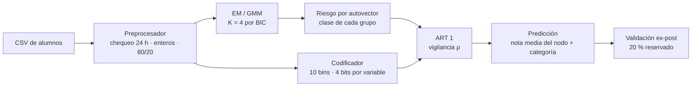
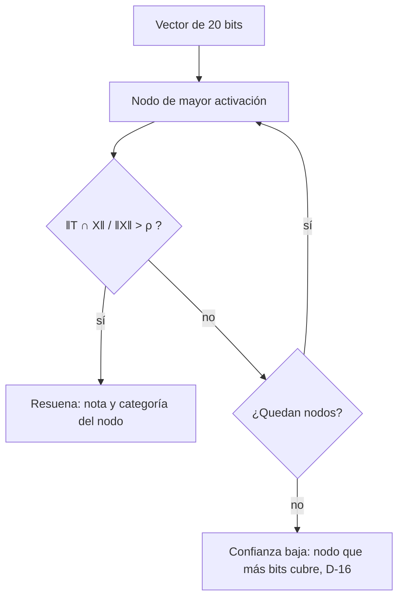
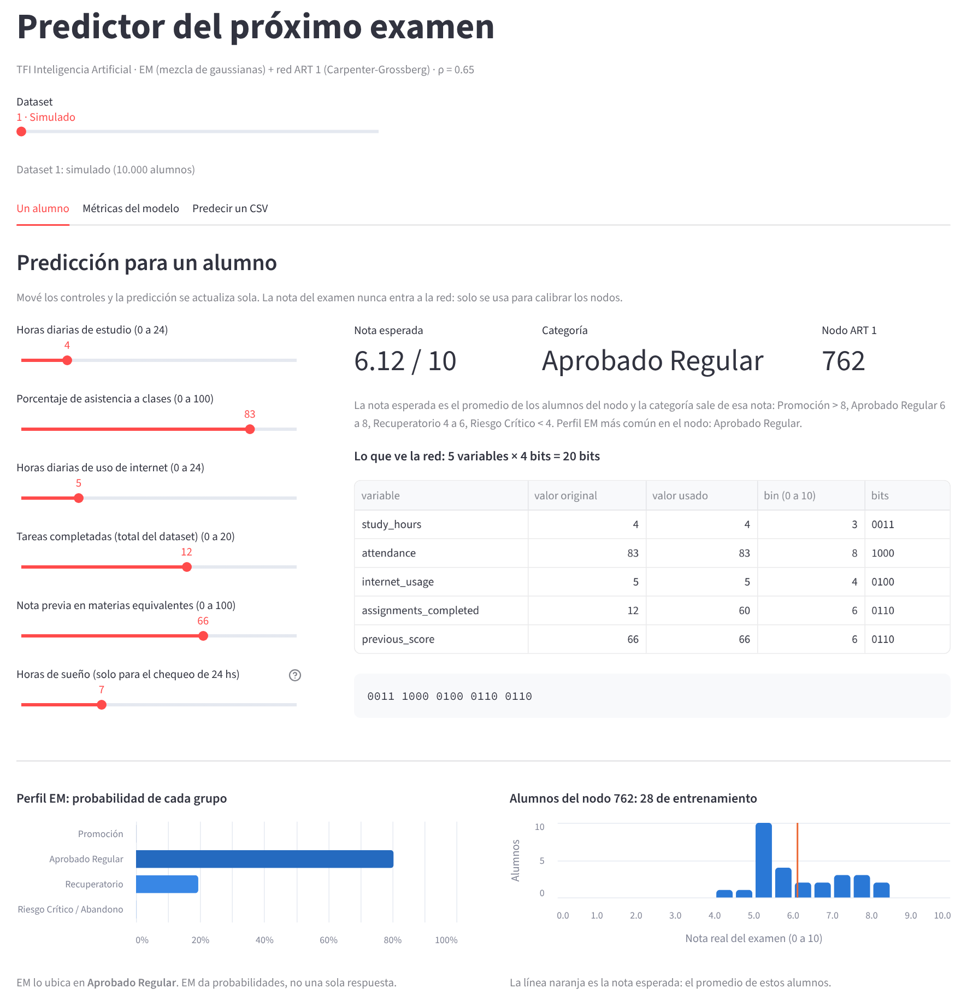
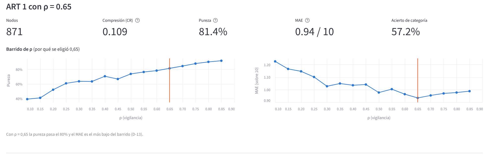
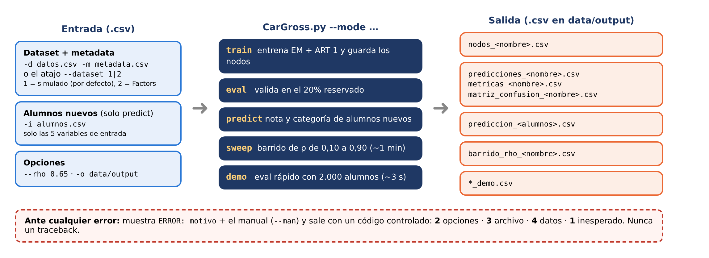

# tfi-ia-prediccion-examenes

Trabajo Final Integrador de Inteligencia Artificial (UADER · FCyT · IDTI Lab).

Predictor **no supervisado híbrido** que estima, para un estudiante, la **nota esperada (0 a 10)** y la
**categoría** de su próximo examen a partir de sus hábitos diarios y antecedentes académicos.
El algoritmo **EM** (mezcla de gaussianas) descubre perfiles de alumnos y una red **ART 1**
(Carpenter-Grossberg 1, Box 3 de Lau, 1992) los aprende en forma binaria.

| Categoría | Nota esperada |
|---|---|
| Promoción | > 8 |
| Aprobado Regular | 6 a 8 |
| Recuperatorio | 4 a 6 |
| Riesgo Crítico | < 4 |

**Fuera de alcance:** alertas de deserción y recomendaciones pedagógicas. El sistema solo predice el
desempeño en el próximo examen.

## Datos

Dataset de 10.000 alumnos en `data/raw/student_performance.csv`.

Variables de entrada: `study_hours`, `internet_usage` (0 a 24 h, 3 dígitos), `attendance`,
`previous_score` (0 a 100) y `assignments_completed` (escalada a 100). `exam_score` es el objetivo y
nunca entra a la red.

**Dataset 2 (benchmark):** [Student Performance Factors](https://www.kaggle.com/datasets/lainguyn123/student-performance-factors)
de Kaggle, 6.607 alumnos, en `data/raw/StudentPerformanceFactors.csv`. Entradas: `Hours_Studied`
(por semana, escalada a 100), `Attendance`, `Sleep_Hours`, `Tutoring_Sessions` (escalada a 100) y
`Previous_Scores`; objetivo `Exam_Score`. Las reglas de cada dataset están en `data/metadata/`.

## Pipeline



Cada alumno pasa a un vector de 20 bits (5 variables × 4 bits):

```
study_hours 7 h  → bin 6 → 0110
attendance  56 % → bin 5 → 0101
internet    7 h  → bin 6 → 0110      vector: 0110 0101 0110 0110 0110
tareas      65   → bin 6 → 0110
previa      62   → bin 6 → 0110
```

Para un alumno nuevo, la red busca el nodo que resuena con su vector (sin aprender) y devuelve la nota
media de ese nodo; la categoría sale de esa nota (D-15):



## Resultados actuales

- **EM:** el BIC tiene su mínimo en K = 4. Los grupos, ordenados por riesgo, tienen notas medias de
  75,9 / 65,0 / 54,7 / 44,4 (sobre 100). Silhouette 0,19.
- **ART 1 con ρ = 0,65:** 871 nodos, pureza 81%, **MAE 0,94 sobre 10** en el 20% reservado
  (media global: 1,33; EM solo: 0,99). Es el ρ elegido (D-13). Acierto de categoría 57,2%.
- **Dataset 2 con los mismos parámetros:** 394 nodos, pureza 84,6%, MAE 0,23 (media global: 0,29).

## Estructura

```
CarGross.py        punto de entrada CLI
src/               preprocessor, em_clustering, encoder, art1, predictor, metrics, barrido_rho,
                   app_visual (app en el navegador)
scripts/           generar y validar el dataset simulado
tests/             tests con pytest
data/              raw (dataset), metadata (reglas de cada variable), output (resultados)
docs/              arquitectura, informe de avance, registro de decisiones y figuras
```

## Manual de usuario

### 1. Instalación (una sola vez)

Hace falta Python 3.10 o más nuevo. Desde la carpeta del proyecto:

```
python -m venv venv
venv\Scripts\activate          (en Linux o Mac: source venv/bin/activate)
pip install -r requirements.txt
python -m pytest               (tienen que pasar todos los tests)
```

Cada vez que se abre una terminal nueva hay que volver a activar el entorno con `venv\Scripts\activate`.

### 2. App visual en el navegador

```
python -m src.barrido_rho            (opcional: genera los gráficos del barrido de ρ)
python -m src.barrido_rho factors
streamlit run src/app_visual.py
```

Se abre sola en `http://localhost:8501` (si no, copiar esa dirección en el navegador). La primera vez
tarda unos segundos porque entrena EM + ART 1. Para cerrarla: `Ctrl + C` en la terminal.



- **Dataset** (control de arriba): pasa del dataset 1 (simulado) al dataset 2 (Student Performance
  Factors). Todas las pestañas cambian de variables.
- **Un alumno:** mover los controles con los hábitos del alumno. Muestra la nota esperada, la categoría,
  el nodo ART 1, el vector de 20 bits que ve la red, la probabilidad de cada perfil EM y las notas de
  los alumnos de ese nodo.
- **Métricas del modelo:** métricas del EM (BIC, AIC, silhouette, entropía) con la curva de BIC por K,
  métricas de ART 1 (nodos, CR, pureza, MAE, acierto) con el barrido de ρ, y la validación en el 20%
  reservado (nota real contra esperada y matriz de confusión).
- **Predecir un CSV:** subir un archivo con las 5 columnas de entrada y descargar las predicciones.
  El botón *Descargar CSV de ejemplo* da un archivo con el formato correcto.



### 3. CLI `CarGross.py`

Es el punto de entrada que pide la cátedra. Todo entra y sale en archivos `.csv`.

```
python CarGross.py --mode demo                          prueba rápida (~3 s)
python CarGross.py --mode eval                          métricas del dataset 1
python CarGross.py --mode eval --dataset 2              métricas del dataset 2
python CarGross.py --mode predict -i alumnos.csv        predecir alumnos nuevos
python CarGross.py --man                                manual completo
```



| Modo | Qué hace | Guarda en `data/output/` |
|---|---|---|
| `train` | Entrena EM + ART 1 y guarda los nodos | `nodos_<nombre>.csv` |
| `eval` | Valida en el 20% reservado y muestra métricas y matriz de confusión | `predicciones_`, `metricas_` y `matriz_confusion_<nombre>.csv` |
| `predict` | Nota y categoría de alumnos nuevos (`-i`, solo las 5 variables de entrada) | `prediccion_<alumnos>.csv` |
| `sweep` | Barrido de ρ de 0,10 a 0,90 (~1 min) | `barrido_rho_<nombre>.csv` |
| `demo` | `eval` con los primeros 2.000 alumnos del dataset 1 | `*_demo.csv` |

Opciones: `-d datos.csv -m metadata.csv` (otro dataset, van juntos) o `--dataset 1|2`, `-o carpeta`
de salida y `--rho` (entre 0 y 1, por defecto 0,65).

Ante cualquier error muestra `ERROR: motivo` y el manual, y sale con un código: **0** bien,
**2** opciones inválidas, **3** archivo inexistente, **4** datos inválidos (faltan columnas, vacíos),
**1** inesperado.

### 4. Los dos datasets

| | Dataset 1 (simulado) | Dataset 2 (benchmark) |
|---|---|---|
| Archivo | `data/raw/student_performance.csv` | `data/raw/StudentPerformanceFactors.csv` |
| Metadata | `data/metadata/student_metadata.csv` | `data/metadata/factors_metadata.csv` |
| Alumnos | 10.000 | 6.607 |
| Entradas | study_hours, attendance, internet_usage, assignments_completed, previous_score | Hours_Studied, Attendance, Sleep_Hours, Tutoring_Sessions, Previous_Scores |
| Objetivo | exam_score | Exam_Score |
| Nombre en los comandos | `student` (por defecto) | `factors` |
| Nodos / pureza / MAE (ρ = 0,65) | 871 / 81,4% / 0,94 | 394 / 84,6% / 0,23 |

Los dos usan el mismo código, K = 4 y ρ = 0,65; lo único que cambia es el metadata. En el dataset 2
el 98% de las notas está entre 6 y 8, así que casi todos los alumnos son Aprobado Regular.

### 5. Scripts de análisis

| Comando | Qué genera |
|---|---|
| `python -m src.metrics [factors]` | `data/output/predicciones_<dataset>.csv` (una fila por alumno del 20% reservado) y `metricas_<dataset>.csv` |
| `python -m src.barrido_rho [factors]` | Tabla del barrido de ρ de 0,10 a 0,90 (la usa la app para sus gráficos) |
| `python scripts/validar_dataset_simulado.py` | Rangos, correlaciones y BIC por K del dataset simulado |

### 6. Problemas comunes

- **`streamlit` no se reconoce como comando:** falta activar el entorno (`venv\Scripts\activate`) o
  correr `pip install -r requirements.txt`.
- **La app dice que corras `python -m src.barrido_rho`:** los CSV de `data/output/` no se versionan;
  hay que generarlos una vez.
- **Faltan columnas en el CSV:** el archivo tiene que tener exactamente los nombres de las variables de
  entrada del dataset elegido (ver la tabla de arriba).
- **El puerto 8501 está ocupado:** `streamlit run src/app_visual.py --server.port 8502`.

El detalle completo (cómo funciona cada pestaña, qué significa cada métrica y cada gráfico) está en
`docs/Informe_avance_TFI.docx`, secciones 7 y 8.

## Equipo

Acuña, Juan (líder) · Blanchet, Sofía · Parodi, Facundo · Pereyra, Lucrecia · Schell, Brian ·
Viñuela, Tomás. Docentes: Dra. Daniela López De Luise y Prof. Alejandro Pérez.
