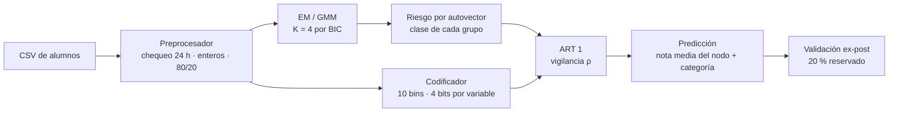
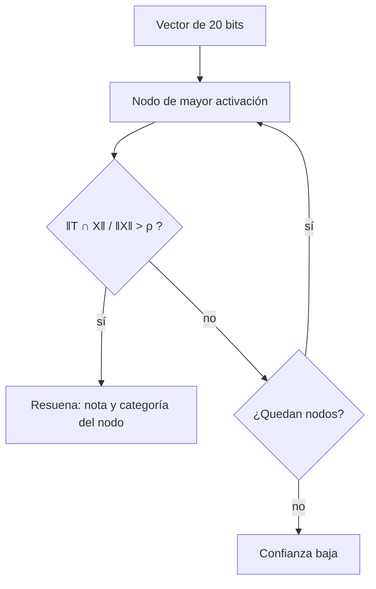

# tfi-ia-prediccion-examenes

Trabajo Final Integrador de Inteligencia Artificial (UADER · FCyT · IDTI Lab).

Predictor **no supervisado híbrido** que estima, para un estudiante, la **nota esperada (0 a 10)** y la
**categoría** de su próximo examen a partir de sus hábitos diarios y antecedentes académicos.
El algoritmo **EM** (mezcla de gaussianas) descubre perfiles de alumnos y una red **ART 1**
(Carpenter-Grossberg 1, Box 3 de Lau, 1992) los aprende en forma binaria.

| Categoría | Nota esperada |
|---|---|
| Promoción | > 8 |
| Aprobado Regular | 6 a 8 |
| Recuperatorio | 4 a 6 |
| Riesgo Crítico | < 4 |

**Fuera de alcance:** alertas de deserción y recomendaciones pedagógicas. El sistema solo predice el
desempeño en el próximo examen.

## Datos

Dataset de 10.000 alumnos en `data/raw/student_performance.csv`.

Variables de entrada: `study_hours`, `internet_usage` (0 a 24 h, 3 dígitos), `attendance`,
`previous_score` (0 a 100) y `assignments_completed` (escalada a 100). `exam_score` es el objetivo y
nunca entra a la red.

## Pipeline



Cada alumno pasa a un vector de 20 bits (5 variables × 4 bits):

```
study_hours 7 h  → bin 6 → 0110
attendance  56 % → bin 5 → 0101
internet    7 h  → bin 6 → 0110      vector: 0110 0101 0110 0110 0110
tareas      65   → bin 6 → 0110
previa      62   → bin 6 → 0110
```

Para un alumno nuevo, la red busca el nodo que resuena con su vector (sin aprender) y devuelve la nota
media y la categoría EM de ese nodo:



## Resultados actuales

- **EM:** el BIC tiene su mínimo en K = 4. Los grupos, ordenados por riesgo, tienen notas medias de
  75,9 / 65,0 / 54,7 / 44,4 (sobre 100). Silhouette 0,19.
- **ART 1 con ρ = 0,65:** 871 nodos, pureza 81%, **MAE 0,94 sobre 10** en el 20% reservado
  (media global: 1,33; EM solo: 0,99). Es el ρ elegido (D-13).

## Estructura

```
CarGross.py        punto de entrada CLI (en desarrollo)
src/               preprocessor, em_clustering, encoder, art1, predictor, metrics, barrido_rho
scripts/           generar y validar el dataset simulado
tests/             tests con pytest
data/              raw (dataset), metadata (reglas de cada variable), output (resultados)
docs/              arquitectura, informe de avance y registro de decisiones
```

## Cómo correrlo

```
python -m venv venv
venv\Scripts\activate
pip install -r requirements.txt
python -m pytest
python scripts/validar_dataset_simulado.py
python -m src.barrido_rho
python -m src.metrics
```

`python -m src.metrics` corre el pipeline con ρ = 0,65 y guarda las predicciones por alumno en
`data/output/predicciones_student.csv` y el resumen en `data/output/metricas_student.csv`.

El detalle completo está en `docs/Informe_avance_TFI.docx` y
`docs/especificacion_arquitectura_em_art1.md`.

## Equipo

Acuña, Juan (líder) · Blanchet, Sofía · Parodi, Facundo · Pereyra, Lucrecia · Schell, Brian ·
Viñuela, Tomás. Docentes: Dra. Daniela López De Luise y Prof. Alejandro Pérez.
