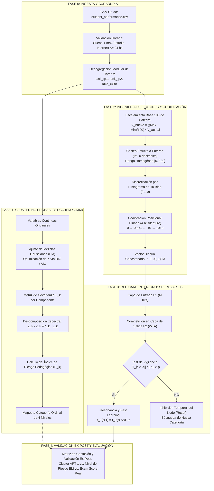
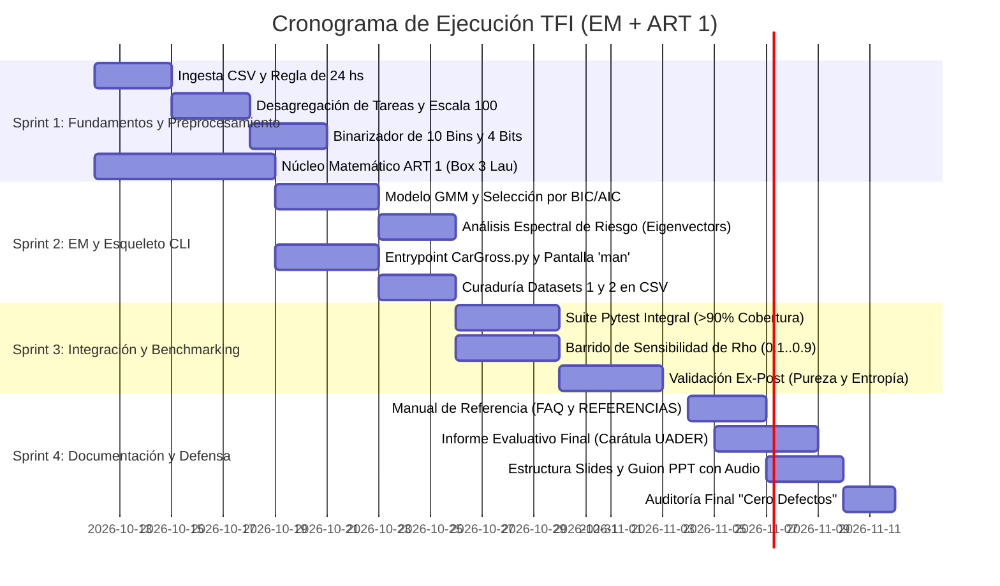

# DOCUMENTO DE ARQUITECTURA, ESPECIFICACIÓN TÉCNICA Y PLAN DE EJECUCIÓN (MASTER TFI)

**Cátedra:** Redes Neuronales  
**Institución:** Universidad Autónoma de Entre Ríos (UADER) – Facultad de Ciencia y Tecnología (FCyT)  
**Laboratorio:** Museo IDTI Lab de Redes Neuronales  
**Docentes:** Dra. Daniela López De Luise – Prof. Alejandro Pérez  
**Proyecto:** Sistema Neuro-Adaptativo Híbrido (EM/GMM + ART 1) para la Predicción del Desempeño en el Próximo Examen  
**Archivo Principal:** `CarGross.py`  
**Modalidad de Aprobación:** Opción Promoción (Régimen de Tolerancia Cero a Fallos, 100% Reproducible y Autodocumentado)  

---

## 1. INTRODUCCIÓN Y MARCO DE APLICACIÓN DEL SISTEMA DE IA

### 1.1 ¿Qué función cumple la IA en el sistema?
El sistema tiene como **única y exclusiva función predecir cómo le va a ir a un alumno en su próximo examen** a partir del análisis de sus hábitos de estudio y conducta académica reciente, antes de que se presente a rendir.

Para lograr esta predicción de forma objetiva (sin sesgos subjetivos ni necesidad de calificaciones previas etiquetadas manualmente), la IA opera como un clasificador híbrido no supervisado en dos etapas:
1. **Perfilado y Abstracción:** Descubre de manera autónoma los patrones de comportamiento de los estudiantes combinando el agrupamiento continuo probabilístico (**Expectation-Maximization / GMM**) con la memoria adaptativa de patrones binarios de **Carpenter-Grossberg 1 (ART 1)**.
2. **Inferencia Predictiva del Examen:** Cuando ingresa un alumno incógnita (cuyos hábitos se conocen pero cuya nota de examen aún no existe), la red lo clasifica en su clúster prototipo más afín y proyecta de forma inmediata:
   - Su **nota esperada en el próximo examen** ($\widehat{\text{Exam Score}}$).
   - Su **intervalo de variación previsto** ($\pm \sigma$).
   - Su **probabilidad condicionada de aprobación** ($P(\text{Aprobar})$).
   - Su **calificación cualitativa esperada** (*Promoción*, *Aprobado Regular*, *Recuperatorio* o *Reprobado*).

---

### 1.2 ¿Qué se espera como entrada (Input)?
La ingesta de datos se realiza **exclusivamente mediante archivos `.csv`**:
1. **Variables del Alumno Previas al Examen (`student_performance.csv`):**
   - **Hábitos diarios:** Horas diarias de estudio (`study_hours`), porcentaje de asistencia a clases (`attendance`), horas de descanso (`sleep_hours`) y uso diario de internet (`internet_usage`).
   - **Desempeño en trabajos del curso:** Entregas y evaluaciones prácticas modulares independientes (`task_tp1`, `task_tp2`, `task_taller`).
   - **Antecedentes académicos:** Nota previa obtenida en materias correlativas o afines (`previous_scores`).
   - *Nota del próximo examen (`Exam Score`):* Durante la consulta/inferencia de un alumno nuevo, este valor es desconocido (la variable incógnita a predecir). Durante la fase de calibración histórica del modelo, se utiliza para fijar la distribución de notas de cada clúster.
2. **Filtro de Coherencia Horaria Obligatorio:** Todos los registros de entrada deben cumplir la restricción física de 24 horas diarias:
   $$\text{Sleep Hours} + \max(\text{Study Hours}, \text{Internet Usage}) \le 24 \text{ hs}$$
3. **Diccionario de Metadatos (`student_metadata.csv`):** Archivo `.csv` auxiliar que define las reglas de desagregación de tareas, rangos esperados $[0, 100]$ y parámetros de binarización posicional para la red.

---

### 1.3 ¿Qué se espera como salida (Output)?
El sistema entrega de forma unificada y precisa la **predicción del desempeño en el próximo examen**:
1. **Nota Numérica Puntual Estimada ($\widehat{\text{Exam Score}}$):** Media histórica de calificaciones del clúster prototipo asignado:
   $$\widehat{\text{Exam Score}} = \bar{Y}_{j^*}$$
2. **Intervalo de Incertidumbre de la Nota:** Dispersión esperada según la desviación estándar interna del clúster:
   $$[\bar{Y}_{j^*} - \sigma_{j^*}, \; \bar{Y}_{j^*} + \sigma_{j^*}]$$
3. **Calificación Cualitativa del Examen (4 Categorías Directas):**
   - **Promoción Directa:** Nota proyectada $\ge 80$ (excelente dominio, bajo riesgo).
   - **Aprobado Regular:** Nota proyectada entre $60$ y $79$ (cumplimiento suficiente de objetivos).
   - **A Recuperatorio:** Nota proyectada entre $40$ y $59$ (rendimiento frágil, en zona de riesgo).
   - **Reprobado / Insuficiente:** Nota proyectada $< 40$ (alto riesgo de desaprobar el examen).
4. **Probabilidad Condicionada de Aprobación:** Porcentaje de alumnos históricos del mismo perfil que lograron aprobar el examen ($y \ge 60$):
   $$P(\text{Aprobar Examen} \mid X) = \frac{N_{\text{aprobados en clúster } j^*}}{N_{\text{total en clúster } j^*}} \times 100\%$$
5. **Métricas de Confiabilidad del Modelo:** Reporte en consola de la Pureza de Clúster ($\ge 80\%$), Criterios BIC/AIC de EM, Tasa de Compresión ($\text{CR}$) y Frecuencia de Resets ($\text{RR}$).
6. **Interfaz CLI Resiliente y Manual `man`:** Reporte claro en terminal ante predicciones exitosas y despliegue automático del manual interactivo ante parámetros faltantes o datos inconsistentes.

---

### 1.4 ¿Qué utilización práctica se le va a dar? (Alcance Estrictamente Acotado)
El rango de utilidad del programa se circunscribe **únicamente a la predicción preventiva del próximo examen**:
1. **Para el Estudiante (Autodiagnóstico Preventivo):** El alumno ingresa sus hábitos actuales antes de la fecha del examen para responder una única pregunta: *"Con mis horas de estudio y asistencia actuales, ¿cómo me va a ir en el próximo examen?"*. Si la predicción anticipa un resultado de *Recuperatorio* o *Reprobado*, el alumno recibe una alerta temprana concreta con la oportunidad de ajustar sus hábitos (aumentar horas de estudio, completar tareas pendientes) antes de rendir la prueba.
2. **Para el Docente (Proyección Anticipada del Examen):** Días antes de la evaluación, el docente ingresa los hábitos registrados de su comisión para conocer de antemano la distribución esperada del examen (cuántos promocionarán, cuántos aprobaran y cuántos alumnos están en trayectoria directa hacia la reprobación), permitiéndole reforzar temas críticos o advertir a los alumnos en riesgo previo al examen.

---

## 2. ESPECIFICACIONES OBLIGATORIAS Y RESTRICCIONES DE CÁTEDRA

1. **Punto de Entrada Único:** El software ejecutable debe centralizarse estrictamente en el módulo Python `CarGross.py`. El código debe ser limpio, autodocumentado según directivas PEP 8 y estar libre de errores de ejecución o advertencias de tipo.
2. **Restricción de Formatos de E/S:** La ingesta y exportación de datos debe realizarse **exclusivamente mediante archivos `.csv`**. Cualquier archivo de configuración o metadato complementario debe tener extensión `.csv` y contar con su documentación tabular asociada.
3. **Interfaz de Usuario:** Interfaz por línea de comandos (CLI). No se admite ni requiere interfaz gráfica (GUI).
4. **Resiliencia y Sistema `man` Integrado:** El software debe implementar control total de excepciones. Ante parámetros faltantes, tipos inválidos, datos corruptos o corridas infructuosas, el script debe interceptar el error, emitir un mensaje de diagnóstico y desplegar automáticamente la pantalla interactiva del manual de referencia (`man`), finalizando con un código de salida controlado.
5. **Conjuntos de Datos Requeridos:** Evaluación y validación sobre dos (2) datasets distintos con un mínimo de 50 instancias y 5 variables cada uno:
   - **Dataset 1 (Principal):** *Student Performance Prediction Dataset* (Kaggle), desagregado y binarizado.
   - **Dataset 2 (Benchmark de Control):** Dataset complementario formateado bajo las mismas reglas para contrastar la estabilidad de la red.
6. **Entregables Formales:**
   - **Manual de Referencia:** Alcances, limitaciones, guía paso a paso de instalación en entorno virtual, ejecución de demo rápida, FAQ con un mínimo de 3 preguntas analíticas y sección final obligatoria bajo el título estricto `REFERENCIAS`.
   - **Informe Final Evaluativo:** Resultados de las corridas en ambos datasets, matrices de validación cruzada y carátula formal institucional con logos de UADER y del IDTI Lab.
   - **Estructura y Guion para PPT con Audio:** Presentación audiovisual didáctica que detalle el origen bio-inspirado del modelo, justificación, dinámica ART 1, fortalezas, debilidades y comparativa exhaustiva contra redes neuronales competidoras.

---

## 2. ARQUITECTURA CONCEPTUAL: MODELO HÍBRIDO EN DOS FASES

El sistema resuelve el trade-off entre la modelización estocástica de variables continuas y la memoria de largo plazo auto-organizativa binaria mediante un pipeline de dos fases acopladas de manera ex-post:



---

## 3. FORMULACIÓN MATEMÁTICA Y FUNDAMENTOS TEÓRICOS

### 3.1 Fase 1: Expectation-Maximization (EM) y Descomposición Espectral

El espacio continuo de hábitos de los estudiantes se modela mediante una combinación lineal convexa de $K$ densidades normales multivariadas:

$$p(x) = \sum_{k=1}^K \pi_k \, \mathcal{N}(x \mid \mu_k, \Sigma_k)$$

donde:
- $\pi_k$ es el coeficiente de mezcla de la componente $k$, satisfaciendo $\sum_{k=1}^K \pi_k = 1$ y $\pi_k \ge 0$.
- $\mu_k \in \mathbb{R}^D$ es el vector de medias (centroide) en el espacio continuo de dimensión $D$.
- $\Sigma_k \in \mathbb{R}^{D \times D}$ es la matriz de covarianza de la componente $k$.

La función de Log-Likelihood total a maximizar mediante el algoritmo EM es:

$$\ln L(\theta) = \sum_{i=1}^N \ln \left( \sum_{k=1}^K \pi_k \, \frac{1}{(2\pi)^{D/2} |\Sigma_k|^{1/2}} \exp\left( -\frac{1}{2}(x_i - \mu_k)^T \Sigma_k^{-1} (x_i - \mu_k) \right) \right)$$

#### A. Calibración Óptima de Componentes ($K$)
Para evitar la subsegmentación o sobreajuste de la red, la selección de $K$ se determina evaluando el Criterio de Información Bayesiano (BIC) y el Criterio de Información de Akaike (AIC):

$$\text{BIC} = -2 \ln \hat{L} + p \ln N$$

$$\text{AIC} = -2 \ln \hat{L} + 2p$$

donde $\hat{L}$ es el máximo de la función de verosimilitud, $N$ es la cantidad de estudiantes y $p$ es el número total de parámetros libres estimados:

$$p = (K - 1) + K \cdot D + K \cdot \frac{D(D + 1)}{2}$$

Se selecciona el valor $K^*$ que minimice el BIC en el rango de búsqueda $K \in [2, 7]$.

#### B. Derivación del Gradiente de Riesgo Académico por Eigenvectores
La matriz de covarianza $\Sigma_k$ de cada componente admite una descomposición espectral única:

$$\Sigma_k = V_k \Lambda_k V_k^T = \sum_{d=1}^D \lambda_{k, d} \, v_{k, d} \, v_{k, d}^T$$

donde:
- $\Lambda_k = \operatorname{diag}(\lambda_{k, 1}, \lambda_{k, 2}, \dots, \lambda_{k, D})$ contiene los autovalores ordenados en forma decreciente: $\lambda_{k, 1} \ge \lambda_{k, 2} \ge \dots \ge \lambda_{k, D} \ge 0$.
- $V_k = [v_{k, 1}, v_{k, 2}, \dots, v_{k, D}]$ es la base ortonormal de autovectores. El autovector principal $v_{k, 1} \in \mathbb{R}^D$ define la dirección del semieje mayor del elipsoide de dispersión del clúster.

Se define el **vector canónico de orientación académica** $\mathbf{w}_{acad} \in \mathbb{R}^D$:

$$\mathbf{w}_{acad} = [w_{study}, w_{attend}, w_{sleep}, w_{net}, w_{tp1}, w_{tp2}, w_{taller}, w_{prev}]^T$$

con coeficientes normalizados donde los hábitos favorables presentan signo positivo ($+1$), los hábitos de ocio no controlado signo negativo ($-1$) y las variables fisiológicas ponderaciones estables.

Para cada componente $k$, se calculan:
1. **Desempeño Medio Proyectado ($\bar{P}_k$):**
   $$\bar{P}_k = \mathbf{w}_{acad}^T \mu_k$$

2. **Alineación del Eje de Máxima Varianza ($\alpha_k$):**
   $$\alpha_k = \mathbf{w}_{acad}^T v_{k, 1}$$
   Un valor $\alpha_k < 0$ indica que la principal dispersión del grupo se orienta hacia el detrimento académico.

3. **Volumen de Incertidumbre / Varianza Total ($\mathcal{V}_k$):**
   $$\mathcal{V}_k = \operatorname{Tr}(\Sigma_k) = \sum_{d=1}^D \lambda_{k, d}$$

Se formula el **Índice de Riesgo Pedagógico ($\mathcal{R}_k$)**:

$$\mathcal{R}_k = \frac{\mathcal{V}_k}{\bar{P}_k + \epsilon} \cdot \left(1 - \alpha_k\right)$$

Los componentes se ordenan de forma monótona creciente según $\mathcal{R}_k$ y se asignan a las cuatro categorías ordinales obligatorias:

$$\text{Categoría}(k) = \begin{cases} 
\text{Promoción} & \text{si } \operatorname{Rank}(\mathcal{R}_k) = 1 \\
\text{Aprobado Regular} & \text{si } \operatorname{Rank}(\mathcal{R}_k) = 2 \\
\text{Recuperatorio} & \text{si } \operatorname{Rank}(\mathcal{R}_k) = 3 \\
\text{Riesgo Crítico / Abandono} & \text{si } \operatorname{Rank}(\mathcal{R}_k) \ge 4 
\end{cases}$$

---

### 3.2 Fase 2: Ingeniería de Atributos, Escalamiento y Binarización Posicional

1. **Desagregación de Tareas:** La variable original `assignments_completed` se divide en tres variables independientes: `task_tp1`, `task_tp2` y `task_taller`, rompiendo la ambigüedad de un único escalar global.
2. **Fórmula de Escalamiento a Base 100 de Cátedra:** Cada variable continua se transforma mediante la fórmula:
   $$\text{Valor Nuevo} = \left(\frac{\text{Max} - \text{Min}}{100}\right) \times \text{Valor Actual}$$
3. **Cero Decimales y Magnitud Homogénea:** El valor obtenido se redondea formalmente al entero más cercano y se castea a tipo entero nativo (`int`), acotándolo en el intervalo $[0, 100]$:
   $$\text{Valor Final} = \operatorname{clip}\left( \left\lfloor \text{Valor Nuevo} + 0.5 \right\rfloor, 0, 100 \right) \in \mathbb{Z}$$
4. **Discretización por Histograma en 10 Bins:** Para cada variable entera, se divide el dominio $[0, 100]$ en 10 intervalos uniformes de ancho $h = 10$, asignando a cada instancia un índice de bin entero $b \in \{0, 1, 2, \dots, 10\}$:
   $$b = \min\left( \left\lfloor \frac{\text{Valor Final}}{10} \right\rfloor, 10 \right)$$
5. **Codificación Posicional Binaria (4 bits):** Cada índice $b$ se transforma en su representación binaria pura de 4 bits:
   $$\begin{aligned}
   0 &\longrightarrow [0, 0, 0, 0] \\
   1 &\longrightarrow [0, 0, 0, 1] \\
   2 &\longrightarrow [0, 0, 1, 0] \\
   3 &\longrightarrow [0, 0, 1, 1] \\
   4 &\longrightarrow [0, 1, 0, 0] \\
   5 &\longrightarrow [0, 1, 0, 1] \\
   6 &\longrightarrow [0, 1, 1, 0] \\
   7 &\longrightarrow [0, 1, 1, 1] \\
   8 &\longrightarrow [1, 0, 0, 0] \\
   9 &\longrightarrow [1, 0, 0, 1] \\
   10 &\longrightarrow [1, 0, 1, 0]
   \end{aligned}$$
   Para un registro compuesto por $D$ variables, el vector de entrada resultante para la capa $F_1$ de la red es:
   $$X = [x_0, x_1, \dots, x_{4D - 1}]^T \in \{0, 1\}^{4D}$$

---

### 3.3 Fase 3: Dinámica Algorítmica ART 1 (Box 3, Clifford Lau, 1992)

La red Carpenter-Grossberg 1 opera bajo la dinámica estricta descrita en el material oficial (*Lau, 1992, pp. 12-14*):

#### Paso 1: Inicialización
- Dimensión de entrada: $N = 4D$ bits. Capacidad máxima de categorías en $F_2$: $M$.
- Parámetro de vigilancia: $\rho \in (0, 1]$.
- Pesos de avance (*Bottom-Up*):
  $$b_{ij}(0) = \frac{1}{1 + N}, \quad 0 \le i \le N - 1, \; 0 \le j \le M - 1$$
- Pesos de realimentación (*Top-Down*):
  $$t_{ji}(0) = 1, \quad 0 \le i \le N - 1, \; 0 \le j \le M - 1$$

#### Paso 2: Presentación del Vector de Entrada
Se ingresa el vector binario $X \in \{0, 1\}^N$.

#### Paso 3: Cálculo de Activación en la Capa de Salida ($F_2$)
Se calcula el puntaje de coincidencia $\mu_j$ para todas las categorías $j$ no inhibidas:

$$\mu_j = \sum_{i=0}^{N-1} b_{ij}(t) \, x_i = B_j^T X, \quad 0 \le j \le M - 1$$

#### Paso 4: Selección de la Categoría Candidata (*Winner-Take-All / Maxnet*)
Mediante inhibición lateral extensiva, se escoge el nodo con activación máxima:

$$\mu_{j^*} = \max_{j \in \text{Activos}} (\mu_j)$$

#### Paso 5: Test de Vigilancia
Se contrasta la similitud entre la plantilla prototípica del nodo ganador $T_{j^*}$ y el vector presentado $X$:

$$\|X\| = \sum_{i=0}^{N-1} x_i, \qquad \|T_{j^*} \cap X\| = \sum_{i=0}^{N-1} t_{j^* i}(t) \, x_i$$

$$\text{Criterio:} \quad \frac{\|T_{j^*} \cap X\|}{\|X\|} > \rho$$

- **Si es afirmativo ($\text{Ratio} > \rho$):** Ocurre la **Resonancia Adaptativa**. Proceder al **Paso 7**.
- **Si es negativo ($\text{Ratio} \le \rho$):** Se activa la señal de **Mismatch Reset**. Proceder al **Paso 6**.

#### Paso 6: Inhibición del Nodo y Búsqueda (*Reset Mechanism*)
La salida del nodo ganador $j^*$ se inhibe temporalmente ($\mu_{j^*} = -\infty$) durante la presentación de $X$. Si restan nodos disponibles, se retorna al **Paso 3**. Si todos los nodos comprometidos fallan el test de vigilancia, se compromete un nuevo nodo virgen (*uncommitted node*), pasando al **Paso 7**.

#### Paso 7: Adaptación de Pesos (*Fast Learning*)
El prototipo top-down se actualiza aplicando el operador lógico binario AND entre la plantilla almacenada y la entrada actual:

$$t_{j^* i}(t + 1) = t_{j^* i}(t) \cdot x_i = t_{j^* i}(t) \wedge x_i$$

La matriz de pesos bottom-up asociada al nodo ganador se actualiza conforme a:

$$b_{ij^*}(t + 1) = \frac{t_{j^* i}(t + 1)}{0.5 + \sum_{k=0}^{N-1} t_{j^* k}(t + 1)} = \frac{t_{j^* i}(t + 1)}{0.5 + \|T_{j^*}(t + 1)\|}$$

#### Paso 8: Reactivación y Siguiente Ciclo
Se restablecen todas las inhibiciones aplicadas en el Paso 6 y se presenta la siguiente instancia.

---

### 3.4 Fenómeno de Degradación por AND y Calibración de $\rho$

Dado que la actualización top-down es conjuntiva ($t_{j^* i}(t+1) = t_{j^* i}(t) \wedge x_i$), cualquier bit en `0` presente en un vector admitido extinguirá irrevocablemente el bit correspondiente en la memoria del clúster:

$$t_{j^* i}(t_k) = 0 \implies t_{j^* i}(t_m) = 0, \quad \forall m > k$$

- Si el parámetro de vigilancia $\rho$ se configura excesivamente bajo ($\rho < 0.40$), patrones disímiles o ruidosos convergerán en un mismo nodo, vaciando progresivamente la plantilla hacia un vector nulo ($T_{j^*} \to \mathbf{0}$), provocando saturación categórica.
- Si $\rho$ se sitúa excesivamente cerca de la unidad ($\rho > 0.90$), variaciones mínimas de un único bit dispararán la señal de Reset, forzando la creación innecesaria de un nodo por cada patrón y destruyendo la capacidad de abstracción.
- **Estrategia de Mitigación:** Se implementa un barrido sistemático de sensibilidad $\rho \in [0.10, 0.90]$ con paso $0.05$ sobre el 80% del conjunto de entrenamiento, identificando la meseta de estabilidad donde la tasa de compresión $\text{CR} \in [0.08, 0.20]$ y la tasa de reset se mantengan controladas.

---

### 3.5 Matriz Consolidada de Métricas de Evaluación

| Nivel del Sistema | Métrica Formal | Expresión Matemática | Criterio de Éxito / Interpretación |
| :--- | :--- | :--- | :--- |
| **EM: Ajuste** | Log-Likelihood ($\ln L$) | $\sum_{i=1}^N \ln \sum_{k=1}^K \pi_k \mathcal{N}(x_i \mid \mu_k, \Sigma_k)$ | Convergencia monotónica estricta del algoritmo EM. |
| **EM: Parsimonia** | Criterio BIC | $-2 \ln \hat{L} + p \ln N$ | Mínimo local que define la cantidad óptima $K^*$. |
| **EM: Parsimonia** | Criterio AIC | $-2 \ln \hat{L} + 2p$ | Indicador complementario de penalización paramétrica. |
| **EM: Cohesión** | Silhouette Score ($s$) | $s_i = \frac{b(i) - a(i)}{\max(a(i), b(i))}$ | Promedio global $s \ge 0.40$ sobre datos continuos. |
| **EM: Certeza** | Entropía de Responsabilidades | $H_{\gamma} = -\frac{1}{N} \sum_{i, k} \gamma_{ik} \ln(\gamma_{ik} + \epsilon)$ | $H_{\gamma} \to 0$ indica fronteras gaussianas bien definidas. |
| **ART 1: Pureza** | Pureza de Clúster Ex-Post | $\text{Purity} = \frac{1}{N} \sum_{j} \max_{c} \|C_j \cap L_c\|$ | $\ge 80\%$ respecto al estado ordinal de riesgo EM. |
| **ART 1: Dispersión** | Entropía de Notas de Examen | $\sigma_j^2(\text{Exam Score}) = \frac{1}{|C_j|} \sum_{i \in C_j} (y_i - \bar{y}_j)^2$ | Varianza mínima dentro de cada nodo consolidado. |
| **ART 1: Memoria** | Tasa de Compresión ($\text{CR}$) | $\text{CR} = \frac{M_{\text{activos}}}{N_{\text{total}}}$ | $0.05 \le \text{CR} \le 0.20$; equilibrio entre especificidad y generalización. |
| **ART 1: Dinámica** | Frecuencia de Resets ($\text{RR}$) | $\text{RR} = \frac{\text{Total Resets}}{N_{\text{total}}}$ | Indicador de fricción y divergencia con prototipos. |

---

## 4. ARQUITECTURA DEL REPOSITORIO Y ORGANIZACIÓN DE ARCHIVOS

```text
c:/Users/Juan/Documents/Inteligencia Artificial/TFI/
├── CarGross.py                     # Entrypoint CLI ejecutable unificado (Orquestador principal)
├── requirements.txt                # Dependencias fijadas (numpy>=1.20, pandas>=1.3, scikit-learn>=1.0, pytest>=7.0)
├── README.md                       # Resumen ejecutivo y guía rápida de clonación
├── .gitignore                      # Exclusiones de Git (venv, __pycache__, .pytest_cache)
│
├── src/                            # Módulos desacoplados del sistema
│   ├── __init__.py
│   ├── em_clustering.py            # Clase EMClusterer: GMM, BIC/AIC y descomposición espectral
│   ├── preprocessor.py             # Clase DataPreprocessor: Ingesta, 24hs, desagregación y escalado base 100
│   ├── encoder.py                  # Clase PositionalBinaryEncoder: Histograma 10 bins y codificación 4-bit
│   ├── art1.py                     # Clase CarpenterGrossbergNetwork: Box 3 puro (Lau, 1992)
│   ├── metrics.py                  # Clase ClusterValidator: Métricas unificadas EM + ART 1
│   └── man_pages.py                # Clase ManPageViewer: Manual interactivo integrado ante errores
│
├── data/                           # Ingesta y metadatos strictly en formato CSV
│   ├── raw/
│   │   ├── student_performance.csv # Dataset 1 crudo (Kaggle)
│   │   └── benchmark_features.csv  # Dataset 2 crudo (Benchmark de validación)
│   ├── processed/
│   │   ├── student_scaled_int.csv  # Dataset 1 transformado a enteros en rango [0, 100]
│   │   ├── student_binarized.csv   # Dataset 1 codificado a bits posicionales {0, 1}^M
│   │   ├── benchmark_scaled_int.csv# Dataset 2 transformado a enteros en rango [0, 100]
│   │   └── benchmark_binarized.csv # Dataset 2 codificado a bits posicionales {0, 1}^M
│   └── metadata/
│       ├── student_metadata.csv    # Reglas, desagregación y metadatos del Dataset 1 (CSV)
│       └── benchmark_metadata.csv  # Reglas y metadatos del Dataset 2 (CSV)
│
├── tests/                          # Batería de pruebas automatizadas unitarias e integrales
│   ├── __init__.py
│   ├── test_em_math.py             # Verificación de eigenvectores, cálculo de riesgo y BIC/AIC
│   ├── test_preprocessor.py        # Validación de 24 hs, desagregación y casteo int con 0 decimales
│   ├── test_encoder.py             # Verificación de histograma de 10 bins y codificación en 4 bits
│   ├── test_art1_box3.py           # Dinámica ART 1, pesos b_ij, t_ji, test de vigilancia y reset
│   └── test_cli_man.py             # Comprobación de captura de excepciones y despliegue del 'man'
│
├── docs/                           # Documentación formal de cátedra
│   ├── especificacion_arquitectura_em_art1.md # Master de Arquitectura y Especificación Técnica
│   ├── manual_de_referencia.md     # Alcances, limitaciones, instalación, demo, FAQ y REFERENCIAS
│   ├── informe_evaluativo.md       # Informe académico con carátula oficial UADER / IDTI Lab
│   └── guion_presentacion_ppt.md   # Estructura de slides y guion de audio locutado
│
└── assets/                         # Artefactos visuales y diagramas
    ├── logo_uader.png
    ├── logo_idti.png
    └── sensitivity_rho_curve.png
```

---

## 5. ESPECIFICACIÓN TÉCNICA Y DE CLASES DE `CarGross.py`

### 5.1 Implementación Modular en Python

```python
"""
CarGross.py - Sistema Neuro-Adaptativo Carpenter-Grossberg 1 (ART 1) Híbrido con EM
Cátedra de Redes Neuronales - UADER / IDTI Lab
Módulo principal y CLI de ejecución para la Opción Promoción.
"""

from typing import List, Tuple, Dict, Optional, Any, Union
import sys
import argparse
import numpy as np
import pandas as pd


class EMClusterer:
    """
    Fase 1: Agrupamiento probabilístico de variables continuas originales mediante GMM.
    Determina K óptimo mediante BIC/AIC y calcula el gradiente de riesgo académico
    a través de la descomposición espectral (eigenvectores) de la matriz de covarianza.
    """

    def __init__(self, n_components: Optional[int] = None, max_iter: int = 200, random_state: int = 42):
        self.n_components = n_components
        self.max_iter = max_iter
        self.random_state = random_state
        self.model: Optional[Any] = None
        self.bic_history: Dict[int, float] = {}
        self.aic_history: Dict[int, float] = {}
        self.eigenvalues_: Dict[int, np.ndarray] = {}
        self.eigenvectors_: Dict[int, np.ndarray] = {}
        self.risk_scores_: Dict[int, float] = {}
        self.risk_categories_: Dict[int, str] = {}

    def find_optimal_k(self, X_cont: np.ndarray, k_range: range = range(2, 8)) -> int:
        """
        Evalúa modelos de mezclas gaussianas en el rango k_range y selecciona K por mínimo BIC.
        
        Parámetros:
            X_cont: Matriz continua sin binarizar de dimensiones (N, D).
            k_range: Rango de componentes a evaluar.
            
        Retorna:
            K_optimo: Entero con la cantidad de componentes seleccionada.
        """
        pass

    def fit(self, X_cont: np.ndarray) -> "EMClusterer":
        """
        Ajusta el modelo GMM definitivo y ejecuta la descomposición espectral.
        """
        pass

    def compute_spectral_risk(self, feature_weights: np.ndarray) -> Dict[int, str]:
        """
        Descompone espectralmente Sigma_k = V_k Lambda_k V_k^T para cada componente k.
        Calcula el índice de riesgo pedagógico R_k y clasifica los clústeres en 4 categorías:
        ['Promoción', 'Aprobado Regular', 'Recuperatorio', 'Riesgo Crítico / Abandono'].
        """
        pass

    def predict(self, X_cont: np.ndarray) -> Tuple[np.ndarray, np.ndarray]:
        """
        Retorna:
            labels: Vector de índices de componentes EM asignados a cada instancia.
            responsibilities: Matriz posterior gamma_ik de dimensiones (N, K).
        """
        pass


class DataPreprocessor:
    """
    Fase 2A: Limpieza, validación horaria, desagregación de tareas
    y escalamiento obligatorio a base 100 con conversión estricta a int (0 decimales).
    """

    def __init__(self, metadata_path: str):
        self.metadata_path = metadata_path
        self.metadata_df = pd.read_csv(metadata_path)

    def validate_hourly_consistency(self, df: pd.DataFrame) -> pd.DataFrame:
        """
        Verifica la restricción de consistencia diaria:
            sleep_hours + max(study_hours, internet_usage) <= 24 hs
        Lanza ValueError ante inconsistencias no subsanables.
        """
        pass

    def disaggregate_assignments(self, df: pd.DataFrame) -> pd.DataFrame:
        """
        Desagrega la columna 'assignments_completed' en variables independientes:
        'task_tp1', 'task_tp2', 'task_taller' según metadatos tabulares.
        """
        pass

    def scale_to_base_100_int(self, df: pd.DataFrame, continuous_cols: List[str]) -> pd.DataFrame:
        """
        Aplica la fórmula de cátedra:
            V_nuevo = ((Max - Min) / 100.0) * V_actual
        Aplica redondeo formal y casteo a int. Asegura magnitudes de 2 a 3 dígitos [0, 100].
        """
        pass


class PositionalBinaryEncoder:
    """
    Fase 2B: Binarización estricta para la capa F1 de la red ART 1.
    Discretiza cada variable entera en un histograma de 10 bins (índices 0 a 10)
    y lo codifica como un vector de 4 bits posicionales.
    """

    def __init__(self, num_bins: int = 10, bits_per_feature: int = 4):
        self.num_bins = num_bins
        self.bits_per_feature = bits_per_feature

    @staticmethod
    def int_to_4bit_positional(bin_index: int) -> List[int]:
        """
        Codifica un entero 0..10 en su representación binaria de 4 bits:
            0  -> [0, 0, 0, 0]
            1  -> [0, 0, 0, 1]
            ...
            10 -> [1, 0, 1, 0]
        """
        pass

    def fit_transform(self, df_scaled_int: pd.DataFrame, feature_cols: List[str]) -> Tuple[np.ndarray, List[str]]:
        """
        Transforma el DataFrame de enteros en la matriz binaria X in {0, 1}^(len(cols) * 4).
        Retorna (X_binary, feature_bit_names).
        """
        pass


class CarpenterGrossbergNetwork:
    """
    Fase 3: Implementación matemática estricta de ART 1 (Box 3, Clifford Lau, 1992).
    """

    def __init__(self, input_dim: int, max_categories: int = 50, rho: float = 0.75):
        """
        Inicializa las matrices de pesos bottom-up y top-down:
            b_ij(0) = 1 / (1 + N)
            t_ji(0) = 1
        """
        self.input_dim = input_dim
        self.max_categories = max_categories
        self.rho = rho
        
        # Conexiones Bottom-Up (Avance)
        self.b = np.full((input_dim, max_categories), 1.0 / (1.0 + input_dim), dtype=np.float64)
        # Conexiones Top-Down (Realimentación)
        self.t = np.ones((max_categories, input_dim), dtype=np.int32)
        
        self.committed = [False] * max_categories
        self.num_active_clusters = 0
        self.total_resets = 0

    def fit_predict(self, X_bin: np.ndarray) -> np.ndarray:
        """
        Ajusta la red mediante presentación secuencial de vectores binarios y
        retorna el vector de categorías ganadoras.
        """
        pass

    def evaluate_pattern(self, x: np.ndarray, update: bool = True) -> Tuple[int, int]:
        """
        Ejecuta el ciclo de activación F2, test de vigilancia (||T_j* ∩ X|| / ||X|| > rho),
        mecanismo de reset ante mismatch y actualización Fast Learning.
        
        Retorna:
            (winner_cluster_index, reset_count)
        """
        pass


class ClusterValidator:
    """
    Fase 4: Métricas de rendimiento y validación cruzada ex-post.
    """

    @staticmethod
    def calculate_cluster_purity(assigned_clusters: np.ndarray, real_categories: np.ndarray) -> float:
        """Calcula la pureza global respecto a la clasificación de riesgo derivada de EM."""
        pass

    @staticmethod
    def calculate_exam_score_entropy(assigned_clusters: np.ndarray, exam_scores: np.ndarray) -> Dict[int, float]:
        """Calcula la varianza interna de las notas de examen en cada nodo consolidado."""
        pass

    @staticmethod
    def compute_summary_table(assigned_clusters: np.ndarray, em_labels: np.ndarray, exam_scores: np.ndarray) -> pd.DataFrame:
        """Genera la tabla ex-post comparativa exigida en el informe final."""
        pass


class ManPageViewer:
    """
    Paginador interactivo para terminal del Manual de Referencia de CarGross.
    Se dispara mediante flag explícito (--man) o ante excepciones en tiempo de ejecución.
    """

    @staticmethod
    def render(error_message: Optional[str] = None, exit_code: int = 0) -> None:
        """Imprime la pantalla man completa, resaltando errores si los hubiere."""
        pass
```

---

### 5.2 Comportamiento del Sistema `man` y Manejo de Errores

El entrypoint `CarGross.py` envuelve todo el flujo en un bloque try-catch global de alto nivel:

```python
def main():
    try:
        parser = build_cli_parser()
        args = parser.parse_args()
        
        if args.man:
            ManPageViewer.render(exit_code=0)
            return

        run_pipeline(args)

    except SystemExit as se:
        # argparse dispara SystemExit(2) ante errores de flags
        if se.code != 0:
            ManPageViewer.render(
                error_message="Error de sintaxis en los argumentos de consola suministrados.",
                exit_code=se.code
            )
    except FileNotFoundError as fnf:
        ManPageViewer.render(
            error_message=f"Archivo CSV no encontrado: {fnf.filename}",
            exit_code=1
        )
    except ValueError as ve:
        ManPageViewer.render(
            error_message=f"Fallo de validación en los datos: {str(ve)}",
            exit_code=2
        )
    except Exception as ex:
        ManPageViewer.render(
            error_message=f"Excepción inesperada en la ejecución del pipeline: {str(ex)}",
            exit_code=3
        )

if __name__ == "__main__":
    main()
```

---

## 6. PLAN DE TRABAJO (ROADMAP / WBS Y CRONOGRAMA)

Se estructuran cuatro (4) Sprints de trabajo secuencial e integrado orientados al cumplimiento de la opción promoción:



### 6.1 Matriz de Responsabilidades (RACI)

*Convención:* **R** = Responsable de ejecución, **A** = Aprobador final (Tech Lead), **C** = Consultado, **I** = Informado.

| Módulo / Entregable | Rol 1: Core Algorítmico ART 1 | Rol 2: Pipeline EM & Features | Rol 3: QA, CLI & Datasets | Rol 4: Docs, Manual & PPT |
| :--- | :---: | :---: | :---: | :---: |
| **Núcleo Matemático ART 1 (Box 3 Lau)** | **R / A** | C | C | I |
| **Lazo de Resonancia, Reset y Fast Learning** | **R / A** | C | C | I |
| **Análisis de Sensibilidad de Vigilancia ($\rho$)** | **R** | C | C | I |
| **Ajuste GMM y Selección K por BIC/AIC** | C | **R / A** | C | I |
| **Derivación de Riesgo por Eigenvectores ($\Sigma_k$)** | C | **R / A** | C | I |
| **Desagregación, Escala Base 100 y Binarizador 4-bit** | C | **R** | C | I |
| **CLI `CarGross.py` y Sistema `man` ante Errores** | C | C | **R / A** | I |
| **Curaduría y Formateo CSV de Datasets 1 y 2** | I | C | **R** | I |
| **Suite de Tests Unitarios (`pytest`) y Ex-Post** | C | C | **R** | I |
| **Manual de Referencia (Instalación, Demo, FAQ)** | C | I | I | **R / A** |
| **Informe Final Evaluativo (Carátula UADER/IDTI)** | C | C | C | **R / A** |
| **Estructura y Guion Técnico para PPT con Audio** | C | C | I | **R / A** |

---

## 7. BACKLOG DETALLADO Y ACCIONABLE POR ROL

### 👤 ROL 1: Algoritmo y Núcleo Matemático (Líder Técnico)
*Foco: Motor de inferencia ART 1, estabilidad plástica, dinámica de resonancia y control de degradación.*

- [ ] **ISSUE-101 [CORE]: Inicialización y Feedforward de la Red ART 1**
  - *Descripción:* Implementar en `src/art1.py` la inicialización estricta de conexiones bottom-up $b_{ij}(0) = \frac{1}{1 + N}$ y top-down $t_{ji}(0) = 1$, junto con el cálculo de activación feedforward $\mu_j = \sum_{i=0}^{N-1} b_{ij} x_i$.
  - *Criterio de Aceptación (DoD):* Test unitario que confirme inicialización matricial exacta para dimensiones arbitrarias de bits y respuesta idéntica ante vectores ortogonales.
- [ ] **ISSUE-102 [CORE]: Lazo de Resonancia Adaptativa, Reset y Fast Learning**
  - *Descripción:* Programar el test de vigilancia $\frac{\|T_{j^*} \cap X\|}{\|X\|} > \rho$. En caso de fallo, inhibir temporalmente el nodo ganador ($\mu_{j^*} = -\infty$) y continuar la competición WTA. En caso de acierto, ejecutar la actualización conjuntiva top-down $t_{j^* i}(t+1) = t_{j^* i}(t) \wedge x_i$ y actualizar la matriz de pesos $b_{ij^*}$.
  - *Criterio de Aceptación (DoD):* Prueba con 10 patrones controlados verificando convergencia en número finito de ciclos y ausencia de loops infinitos.
- [ ] **ISSUE-103 [CORE]: Análisis de Sensibilidad del Hiperparámetro $\rho$**
  - *Descripción:* Crear la función de barrido paramétrico $\rho \in [0.10, 0.90]$ con paso $0.05$ para medir el número de clústeres resultantes, la tasa de compresión ($\text{CR}$) y la frecuencia de resets ($\text{RR}$).
  - *Criterio de Aceptación (DoD):* Generar tabla tabular estructurada exportable a CSV con el análisis de los 17 puntos de evaluación para ambos datasets.

---

### 👤 ROL 2: Pipeline EM y Feature Engineering (Lead Data Scientist)
*Foco: Modelado estocástico continuo, descomposición espectral de covarianza y codificación posicional binaria.*

- [ ] **ISSUE-201 [EM]: Modelado GMM y Selección de Componentes por BIC/AIC**
  - *Descripción:* Programar en `src/em_clustering.py` el ajuste de mezclas gaussianas sobre las variables continuas. Evaluar $K \in [2, 7]$ registrando BIC, AIC y Log-Likelihood, seleccionando el mínimo BIC.
  - *Criterio de Aceptación (DoD):* Gráfico o tabla de curvas de información que justifique analíticamente la cantidad de componentes $K$ elegida.
- [ ] **ISSUE-202 [EM]: Extracción de Gradiente de Riesgo por Eigenvectores ($\Sigma_k$)**
  - *Descripción:* Implementar la descomposición espectral $\Sigma_k v = \lambda v$. Computar el índice de riesgo $\mathcal{R}_k$ a partir de la proyección del centroide sobre el autovector principal y la varianza acumulada, ordenando los grupos en: *Promoción*, *Aprobado Regular*, *Recuperatorio* y *Riesgo Crítico / Abandono*.
  - *Criterio de Aceptación (DoD):* Salida verificada que etiquete cada instancia con su clase EM y su nivel ordinal de riesgo académico asociado.
- [ ] **ISSUE-203 [FE]: Desagregación, Escalamiento Base 100 y Codificación 4-Bit**
  - *Descripción:* Desarrollar en `src/preprocessor.py` y `src/encoder.py`:
    1. Desagregación de la columna de tareas en variables independientes (`task_tp1`, `task_tp2`, `task_taller`).
    2. Escalamiento a base 100 con la fórmula de cátedra, casteando estrictamente a enteros nativos (`int`, 0 decimales).
    3. Discretización en histograma de 10 bins (0 a 10) y conversión a cadenas de 4 bits posicionales ($0000$ a $1010$).
  - *Criterio de Aceptación (DoD):* Matriz $X \in \{0, 1\}^{4D}$ validada formalmente (`assert set(np.unique(X)).issubset({0, 1})`).

---

### 👤 ROL 3: QA, CLI y Datasets (Software Engineer & QA)
*Foco: Entrypoint de consola, resiliencia ante errores, curaduría de datasets y validación ex-post.*

- [ ] **ISSUE-301 [CLI]: Entrypoint `CarGross.py` con Sistema `man` Integrado**
  - *Descripción:* Construir el parser CLI con flags `--dataset`, `--metadata`, `--rho`, `--mode {train, eval, sweep, demo}` y `--man`. Interceptar excepciones y disparar el manual interactivo `src/man_pages.py`.
  - *Criterio de Aceptación (DoD):* Invocación errónea (ej. `python CarGross.py` sin argumentos) despliega el manual completo y finaliza con código de salida `1` o `2` sin emitir trazas de error de Python en consola.
- [ ] **ISSUE-302 [DATA]: Curaduría y Formateo CSV de Datasets 1 y 2**
  - *Descripción:* Limpiar y formatear `student_performance.csv` (Kaggle) y el segundo dataset de benchmark ($\ge 50$ filas, $\ge 5$ columnas). Verificar la regla de coherencia horaria ($\le 24$ hs). Generar sus archivos satélite `metadata.csv` en formato CSV puro.
  - *Criterio de Aceptación (DoD):* Archivos CSV almacenados en `data/raw/` y `data/metadata/` listos para ser consumidos por el sistema.
- [ ] **ISSUE-303 [QA]: Batería Pytest y Validación Ex-Post Cruzada**
  - *Descripción:* Implementar la suite de pruebas unitarias en `tests/` y programar en `src/metrics.py` la matriz de validación ex-post que cruce los clústeres descubiertos por ART 1 contra los niveles ordinales de riesgo EM y la nota real (`Exam Score`).
  - *Criterio de Aceptación (DoD):* Cobertura de pruebas $\ge 90\%$, `pytest` con 100% de éxito y comprobación de pureza global de clúster $\ge 80\%$.

---

### 👤 ROL 4: Documentación Técnica y Presentación (DevRel & Technical Writer)
*Foco: Formalismo académico institucional, manual de operación y narrativa audiovisual.*

- [ ] **ISSUE-401 [DOCS]: Manual de Referencia de `CarGross` (Norma Cátedra)**
  - *Descripción:* Redactar `docs/manual_de_referencia.md` incluyendo: alcances, limitaciones (erosión conjuntiva por AND, supuestos gaussianos en EM), guía paso a paso de instalación en entorno virtual, modo de ejecución del test demo rápido, FAQ con 3+ preguntas analíticas de fondo y sección final titulada strictly `REFERENCIAS` citando a Clifford Lau (1992).
  - *Criterio de Aceptación (DoD):* Documento exhaustivo en Markdown, compatible con exportación a PDF, cumpliendo todos los ítems de las directivas de cátedra.
- [ ] **ISSUE-402 [DOCS]: Informe Final Evaluativo con Carátula UADER/IDTI Lab**
  - *Descripción:* Redactar `docs/informe_evaluativo.md` con carátula formal institucional (logos de UADER y del IDTI Lab, nombres de integrantes, materia, docente, fecha), tablas de resultados comparativos en ambos datasets, curvas de sensibilidad de $\rho$ y justificación epistemológica del modelo.
  - *Criterio de Aceptación (DoD):* Informe académico completo listo para evaluación de promoción.
- [ ] **ISSUE-403 [DOCS]: Estructura de Slides y Guion Técnico para PPT con Audio**
  - *Descripción:* Diseñar en `docs/guion_presentacion_ppt.md` la estructura visual y el texto narrativo locutado para la presentación oral. Justificar el origen en la neurobiología de Grossberg, el dilema estabilidad-plasticidad, la necesidad de EM para variables continuas, la dinámica de resonancia adaptativa y el análisis comparativo exhaustivo contra redes Hopfield, Kohonen SOM y Perceptrón Multicapa.
  - *Criterio de Aceptación (DoD):* Guion didáctico y riguroso con marcas de tiempo estimadas para una duración de 10 a 12 minutos de exposición.

---

## 8. PLAN DE VERIFICACIÓN Y CRITERIOS "CERO DEFECTOS" (OPCIÓN PROMOCIÓN)

1. **Prueba de Instalación Limpia en Entorno Aislado:**
   ```bash
   python -m venv venv_promocion
   venv_promocion\Scripts\activate   # En Windows
   pip install -r requirements.txt
   python CarGross.py --mode demo
   ```
   *Criterio de Éxito:* Ejecución completa en menos de 5 segundos, presentando en pantalla las métricas de EM (BIC/AIC), la asignación de categorías ART 1 y la tabla de validación ex-post sin advertencias de deprecación ni errores.

2. **Prueba de Resiliencia de la CLI y Paginador `man`:**
   ```bash
   python CarGross.py
   python CarGross.py --rho 1.5
   python CarGross.py -d archivo_inexistente.csv
   python CarGross.py --man
   ```
   *Criterio de Éxito:* En ningún caso debe desplegarse un traceback crudo de Python (`Traceback (most recent call last)...`). El sistema debe interceptar la excepción, reportar el código de fallo e imprimir el manual interactivo formateado.

3. **Prueba de Validación Cruzada Ex-Post en Ambos Datasets:**
   ```bash
   python CarGross.py -d data/raw/student_performance.csv -m data/metadata/student_metadata.csv --mode eval
   python CarGross.py -d data/raw/benchmark_features.csv -m data/metadata/benchmark_metadata.csv --mode eval
   ```
   *Criterio de Éxito:* Ambos conjuntos deben generar la matriz de confusión ex-post, reportando una pureza promedio de clúster $\ge 80\%$, varianza de calificaciones reducida y una tasa de compresión $\text{CR} \in [0.05, 0.20]$.
