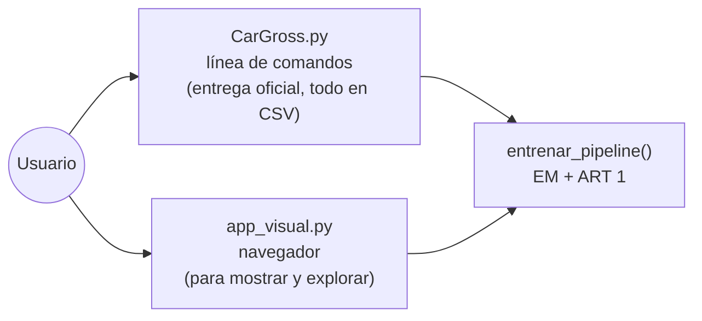
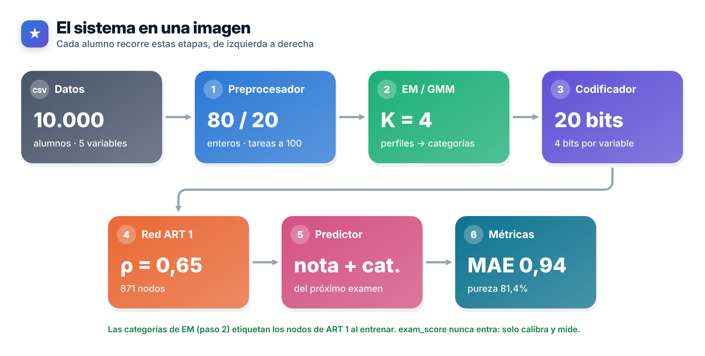
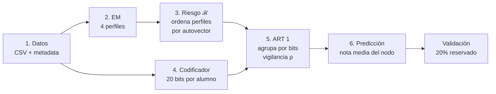
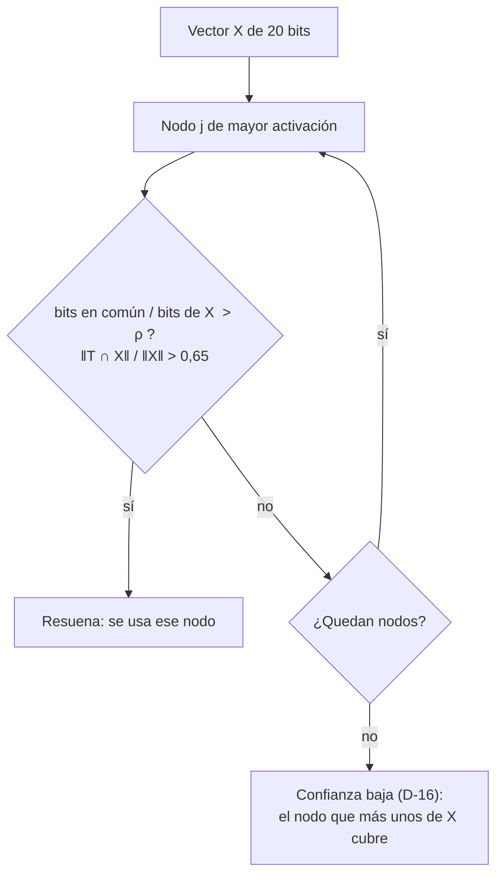
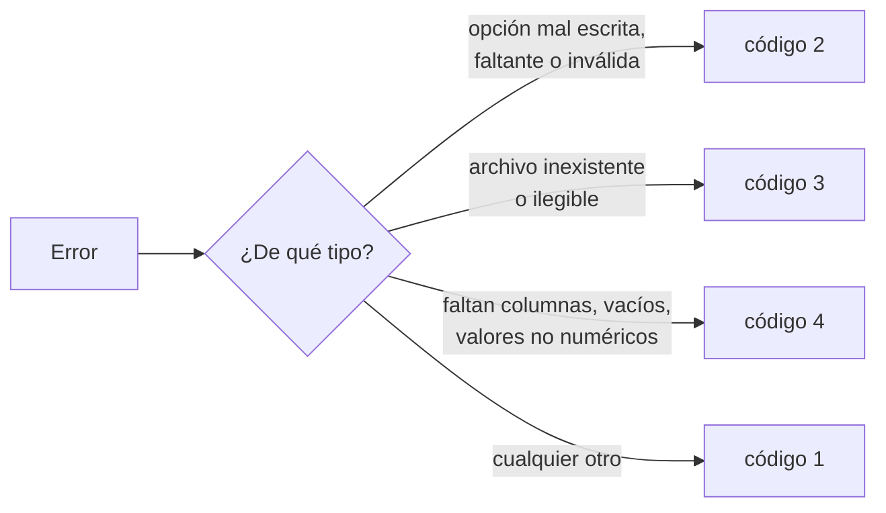
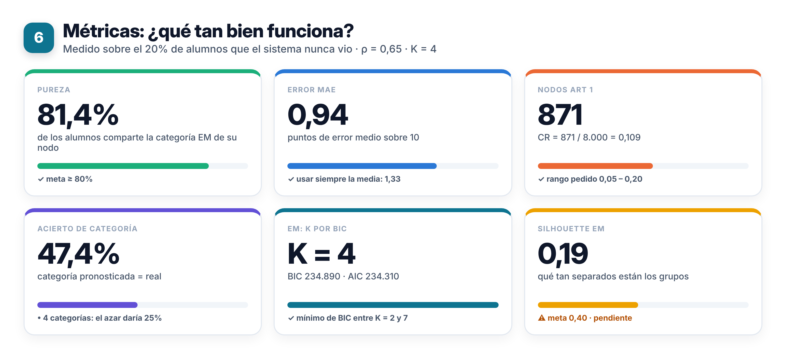
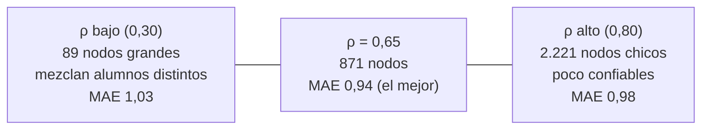

# Manual de referencia de CarGross

**Predictor híbrido EM + ART 1 de la nota del próximo examen**

Trabajo Final Integrador de Inteligencia Artificial · UADER · FCyT · IDTI Lab · 2026

Equipo: Acuña, Juan (líder) · Blanchet, Sofía · Parodi, Facundo · Pereyra, Lucrecia · Schell, Brian ·
Viñuela, Tomás. Docentes: Dra. Daniela López De Luise y Prof. Alejandro Pérez.

---

## Índice

1. [Qué hace el sistema](#1-qué-hace-el-sistema)
2. [Cómo funciona, en una figura](#2-cómo-funciona-en-una-figura)
3. [Un alumno de punta a punta](#3-un-alumno-de-punta-a-punta)
4. [Instalación](#4-instalación)
5. [Demo rápida](#5-demo-rápida)
6. [CLI `CarGross.py`](#6-cli-cargrosspy)
7. [App visual](#7-app-visual)
8. [Los dos datasets y el archivo de metadata](#8-los-dos-datasets-y-el-archivo-de-metadata)
9. [Parámetros y resultados](#9-parámetros-y-resultados)
10. [Limitaciones](#10-limitaciones)
11. [Preguntas frecuentes (FAQ)](#11-preguntas-frecuentes-faq)
12. [REFERENCIAS](#referencias)

---

## 1. Qué hace el sistema

Le das los hábitos y antecedentes de un alumno y te devuelve dos cosas:

| Sale | Ejemplo |
|---|---|
| **Nota esperada** del próximo examen, de 0 a 10 | 5,36 |
| **Categoría** de esa nota | Recuperatorio |

| Categoría | Nota esperada |
|---|---|
| 🟢 Promoción | más de 8 |
| 🔵 Aprobado Regular | de 6 a 8 |
| 🟠 Recuperatorio | de 4 a 6 |
| 🔴 Desaprobado | menos de 4 |

**Alcance.** Solo predice el desempeño en el próximo examen.

**Fuera de alcance** (corrección de cátedra): el sistema **no** emite alertas de deserción ni da
recomendaciones o intervenciones pedagógicas.

Hay dos formas de usarlo, que dan los mismos números porque comparten el mismo código de entrenamiento
(`entrenar_pipeline()` de `src/metrics.py`):



---

## 2. Cómo funciona, en una figura



El sistema es **no supervisado**: nadie le dice a la red qué categoría tiene cada alumno. Trabaja en
seis etapas:



| Etapa | Pregunta que responde | Cómo |
|---|---|---|
| 1. Datos | ¿Los datos son coherentes? | Chequeo de 24 h, enteros, separación 80% entrenamiento / 20% validación |
| 2. EM | ¿Qué tipos de alumno hay? | Mezcla de 4 gaussianas sobre las variables sin transformar (K elegido por BIC) |
| 3. Riesgo ℛ | ¿Cuál de esos tipos rinde mejor? | El autovector principal de cada grupo ordena los perfiles de Promoción a Desaprobado |
| 4. Codificador | ¿Cómo se lo muestro a una red binaria? | Cada variable va a un bin de 0 a 10 y el bin se escribe en 4 bits |
| 5. ART 1 | ¿A qué alumnos se parece este? | La red agrupa vectores parecidos en **nodos**; ρ dice cuánto se tienen que parecer |
| 6. Predicción | ¿Qué nota va a sacar? | La nota media de los alumnos de entrenamiento que cayeron en el mismo nodo |

La figura detallada de cada etapa está en `docs/Esquema_arquitectura_TFI.docx` y en
`docs/figuras_esquema/`.

> **Importante:** la nota del examen (`exam_score`) **nunca** entra a la red. Solo se usa después,
> para saber qué nota media tiene cada nodo.

---

## 3. Un alumno de punta a punta

Un alumno nuevo con estos datos:

| study_hours | attendance | internet_usage | assignments_completed | previous_score |
|---|---|---|---|---|
| 7 h | 56% | 7 h | 13 de 20 | 62 |

**Paso 1, escalar.** Solo las tareas se pasan a base 100: 13 × 100 / 20 = **65**. Las horas quedan en
horas (de 000 a 024) y asistencia y nota previa ya están de 0 a 100.

**Paso 2, bin de 0 a 10.** Las variables de 0 a 100 usan `bin = valor / 10`. Las horas usan bins no
uniformes (D-07), porque casi nadie estudia más de 12 h por día:

| Horas | 0–1 | 2 | 3 | 4 | 5 | 6 | 7 | 8 | 9–10 | 11–12 | más de 12 |
|---|---|---|---|---|---|---|---|---|---|---|---|
| Bin | 0 | 1 | 2 | 3 | 4 | 5 | 6 | 7 | 8 | 9 | 10 |

**Paso 3, 4 bits por variable** (binario posicional, D-12):

```
study_hours     7 h  → bin 6 → 0110
attendance     56 %  → bin 5 → 0101
internet_usage  7 h  → bin 6 → 0110
tareas         65    → bin 6 → 0110
previous_score 62    → bin 6 → 0110

vector que ve la red:  0110 0101 0110 0110 0110   (20 bits)
```

**Paso 4, buscar el nodo que resuena.** La red prueba los nodos de mayor a menor activación hasta que
uno pasa la prueba de vigilancia:



**Paso 5, respuesta.** Este alumno cae en el nodo 654, cuya nota media es **5,36**, así que la
categoría es **Recuperatorio** (la categoría sale de la nota, D-15).

---

## 4. Instalación

Hace falta Python 3.10 o más nuevo. Una sola vez, desde la carpeta del proyecto:

```
python -m venv venv
venv\Scripts\activate              (Linux o Mac: source venv/bin/activate)
pip install -r requirements.txt
python -m pytest                   (tienen que pasar todos los tests)
```

> En Windows, si `python` no se reconoce, usar el lanzador `py`: por ejemplo `py -3.13 -m venv venv`.
> Una vez activado el entorno, `python` ya funciona.

Cada terminal nueva necesita volver a activar el entorno (`venv\Scripts\activate`).

Dependencias (`requirements.txt`): numpy, pandas, scikit-learn (EM), pytest (tests) y streamlit (app).

---

## 5. Demo rápida

```
python CarGross.py --mode demo
```

Entrena y valida con los primeros 2.000 alumnos del dataset 1. Tarda unos 3 segundos y muestra:

```
Demo: primeros 2000 alumnos del dataset 1.
Entrenando EM + ART 1 con rho = 0.65...
nodos                        398
pureza_EM                    0.822
MAE                          0.991
acierto_categoria            0.56
...
real \ pronosticada  Promoción  Aprobado Regular  Recuperatorio  Desaprobado
          Promoción         17                47              4            0
   Aprobado Regular         13               126             41            0
      Recuperatorio          5                36             70            6
        Desaprobado          0                 4             20           11

Guardado: data/output/predicciones_demo.csv
Guardado: data/output/metricas_demo.csv
Guardado: data/output/matriz_confusion_demo.csv
```

Si termina con `Guardado:` y sin `ERROR`, la instalación está bien.

---

## 6. CLI `CarGross.py`

Es el punto de entrada único que pide la cátedra. Toda la entrada y la salida es en `.csv`.


### 6.1 Sinopsis

```
python CarGross.py --mode MODO [-d DATOS.csv -m METADATA.csv | --dataset 1|2]
                   [-i ALUMNOS.csv] [-o CARPETA] [--rho RHO]
python CarGross.py --man
```

### 6.2 Modos

| Modo | Para qué sirve | Tiempo | Guarda en `data/output/` |
|---|---|---|---|
| `demo` | Probar que todo anda | ~3 s | `predicciones_demo.csv`, `metricas_demo.csv`, `matriz_confusion_demo.csv` |
| `train` | Entrenar y ver los nodos de la red | segundos | `nodos_<nombre>.csv` (alumnos, nota media, perfil EM y prototipo de bits de cada nodo) |
| `eval` | Medir qué tan bien predice con el 20% reservado | segundos | `predicciones_`, `metricas_` y `matriz_confusion_<nombre>.csv` |
| `predict` | Predecir alumnos nuevos sin nota (`-i`) | segundos | `prediccion_<nombre del CSV de alumnos>.csv` |
| `sweep` | Probar ρ de 0,10 a 0,90 (paso 0,05) | ~1 min | `barrido_rho_<nombre>.csv` |

`<nombre>` es `student` (dataset 1) o `factors` (dataset 2) con `--dataset`, o el nombre del archivo
de datos con `-d`.

### 6.3 Opciones

| Opción | Qué indica | Por defecto |
|---|---|---|
| `--mode MODO` | train, eval, predict, sweep o demo | obligatoria |
| `--dataset 1\|2` | Atajo: 1 = simulado, 2 = Student Performance Factors | 1 |
| `-d DATOS.csv -m METADATA.csv` | Otro dataset con su metadata (van siempre juntos) | — |
| `-i ALUMNOS.csv` | Alumnos a predecir (solo en `predict`) | — |
| `-o CARPETA` | Carpeta de salida | `data/output` |
| `--rho RHO` | Vigilancia de ART 1, mayor que 0 y hasta 1 | 0,65 |
| `--man`, `-h`, `--help` | Muestra el manual en la terminal | — |

### 6.4 Ejemplos

```
python CarGross.py --mode eval                       métricas del dataset 1
python CarGross.py --mode eval --dataset 2           métricas del dataset 2
python CarGross.py --mode eval --rho 0.70            otro valor de vigilancia
python CarGross.py --mode predict -i alumnos.csv     predecir alumnos nuevos
python CarGross.py --mode eval -d data/raw/student_performance.csv -m data/metadata/student_metadata.csv
```

### 6.5 Predecir alumnos nuevos

El CSV de `-i` lleva **solo las variables de entrada** del dataset elegido, con esos nombres exactos.
Para el dataset 1:

```
study_hours,attendance,internet_usage,assignments_completed,previous_score
7,56,7,13,62
2,40,9,5,35
```

```
python CarGross.py --mode predict -i alumnos.csv
```

Resultado en `data/output/prediccion_alumnos.csv`:

| estudiante | nodo_art1 | nota_esperada | categoria_pronosticada | perfil_em_nodo | confianza_baja |
|---|---|---|---|---|---|
| 1 | 654 | 5,36 | Recuperatorio | Recuperatorio | False |
| 2 | 323 | 2,75 | Desaprobado | Desaprobado | False |

- `perfil_em_nodo`: el perfil EM más común entre los alumnos de ese nodo (informativo).
- `confianza_baja = True`: ningún nodo pasó la vigilancia y se usó el más parecido (D-16).

`predict` usa el modelo entrenado con el 80% de entrenamiento, igual que la app.

### 6.6 Errores y códigos de salida

Ante cualquier problema el programa **no** muestra un traceback de Python: escribe `ERROR: motivo`,
muestra el manual y termina con un código controlado.



| Código | Significado | Ejemplo real |
|---|---|---|
| 0 | Terminó bien | `--mode demo` |
| 2 | Opciones inválidas o faltantes | `--rho 3` → `ERROR: --rho debe estar entre 0 y 1.` |
| 3 | Archivo inexistente o ilegible | `-d nada.csv -m nada.csv` → `ERROR: No existe el archivo nada.csv` |
| 4 | Datos inválidos | un CSV sin la columna `attendance` |
| 1 | Error inesperado | falta instalar scikit-learn → `ERROR: ModuleNotFoundError: No module named 'sklearn'` |

---

## 7. App visual

```
streamlit run src/app_visual.py
```

Se abre en `http://localhost:8501`. Es un complemento para mostrar el modelo; la entrega oficial es la
CLI. Antes conviene correr una vez `python -m src.barrido_rho` y `python -m src.barrido_rho factors`
para que aparezcan los gráficos del barrido de ρ.


| Lugar | Qué muestra |
|---|---|
| Control **Dataset** (arriba) | Pasa del dataset 1 al 2; todas las pestañas cambian de variables |
| Pestaña **Un alumno** | Controles con los hábitos → nota esperada, categoría, nodo, vector de 20 bits, probabilidad de cada perfil EM y notas del nodo |
| Pestaña **Métricas del modelo** | BIC por K, métricas de EM y ART 1, barrido de ρ, nota real contra esperada y matriz de confusión |
| Pestaña **Predecir un CSV** | Subir un CSV, ver y descargar las predicciones (tiene un CSV de ejemplo) |

El detalle de cada pestaña está en el `README.md` (manual de usuario) y en
`docs/Informe_avance_TFI.docx`, sección 7.

---

## 8. Los dos datasets y el archivo de metadata

| | Dataset 1 (simulado) | Dataset 2 (benchmark) |
|---|---|---|
| Archivo | `data/raw/student_performance.csv` | `data/raw/StudentPerformanceFactors.csv` |
| Metadata | `data/metadata/student_metadata.csv` | `data/metadata/factors_metadata.csv` |
| Origen | Simulado, 4 perfiles latentes, semilla 2026 (D-10, aprobado por la docente) | Kaggle, Student Performance Factors (D-18) |
| Alumnos | 10.000 | 6.607 |
| Entradas | study_hours, attendance, internet_usage, assignments_completed, previous_score | Hours_Studied, Attendance, Sleep_Hours, Tutoring_Sessions, Previous_Scores |
| Objetivo | exam_score | Exam_Score |
| En la CLI | `--dataset 1` (por defecto) | `--dataset 2` |

Los dos pasan por **el mismo código**. Lo único que cambia es el metadata, que le dice al sistema qué
hacer con cada columna:

```
variable,rol,tipo,min,max,escalar_a_100,binning,descripcion
study_hours,entrada,horas,0,24,no,horas,Horas diarias de estudio
assignments_completed,entrada,conteo,0,20,si,uniforme,Tareas completadas
sleep_hours,control,horas,0,24,no,ninguno,Horas de sueño (solo chequeo de 24 hs)
exam_score,objetivo,nota,0,100,no,ninguno,Nota del examen (no entra a la red)
```

| Columna | Valores | Qué hace |
|---|---|---|
| `rol` | `entrada` / `objetivo` / `control` | Entra a la red / es la nota a predecir / solo se chequea |
| `tipo` | `horas`, `porcentaje`, `conteo`, `nota`, `horas_semana` | Las de tipo `horas` participan del chequeo de 24 h |
| `min`, `max` | números | Rango de la variable; se usan para escalar |
| `escalar_a_100` | `si` / `no` | Si es `si`: `valor × 100 / (max − min)`, entero |
| `binning` | `horas` / `uniforme` / `ninguno` | Bins no uniformes de horas (D-07) o `valor / 10` |

Para usar **un dataset propio**: armar su metadata con estas columnas (5 variables de `entrada` y una de
`objetivo`) y correr `python CarGross.py --mode eval -d mis_datos.csv -m mi_metadata.csv`.

---

## 9. Parámetros y resultados

| Parámetro | Valor | Por qué |
|---|---|---|
| Variables de entrada | 5 | Pocas variables = vectores cortos y portables a otros datasets (D-01, D-04) |
| K (perfiles EM) | 4 | Mínimo de BIC en el dataset 1 y una clase por categoría (D-08, D-09, D-11) |
| Bits por alumno | 20 (5 × 4) | Binario posicional que pide la cátedra (D-12) |
| ρ (vigilancia) | 0,65 | Primer ρ con pureza ≥ 80% y el menor MAE del barrido (D-13) |

### Resultados en el 20% reservado

| Métrica | Qué mide (en simple) | Dataset 1 | Dataset 2 |
|---|---|---|---|
| Nodos ART 1 | Cuántos grupos armó la red | 871 | 394 |
| Pureza | % de alumnos cuyo nodo tiene su mismo perfil EM | 81,4% | 84,6% |
| **MAE** | Error medio de la nota, en puntos sobre 10 | **0,94** | **0,23** |
| MAE si se da la nota promedio a todos | La vara a superar | 1,33 | 0,29 |
| Acierto de categoría | % de categorías exactas | 57,2% | 98% (poco informativo, ver FAQ) |
| Silhouette EM | Qué tan separados están los perfiles (−1 a 1) | 0,19 | 0,32 |

Ejemplo de cómo leer el MAE: si un alumno sacó 7 y el sistema dijo 6,06, el error es 0,94.

### Barrido de ρ (dataset 1)



| ρ | 0,30 | 0,50 | 0,60 | **0,65** | 0,70 | 0,80 |
|---|---|---|---|---|---|---|
| Nodos | 89 | 419 | 690 | **871** | 1.220 | 2.221 |
| Pureza | 63,7% | 73,8% | 78,3% | **81,4%** | 84,5% | 90,2% |
| MAE | 1,03 | 0,98 | 0,97 | **0,94** | 0,96 | 0,98 |

Más ρ = la red es más exigente = más nodos y más pureza. Pero después de 0,65 los nodos se vuelven tan
chicos (pocos alumnos cada uno) que su nota media es menos confiable y el MAE empeora. Tabla completa:
`python CarGross.py --mode sweep` o `data/output/barrido_rho_art1.csv`.

---

## 10. Limitaciones

| Limitación | En simple | Consecuencia |
|---|---|---|
| **Erosión del prototipo por AND** | Cada vez que un nodo aprende, se queda solo con los bits que comparte con el alumno nuevo (`t = t AND x`). Los prototipos solo pierden unos, nunca los ganan. | Con el tiempo algunos nodos quedan con pocos unos y "aceptan" alumnos bastante distintos. Por eso se entrena hasta 5 épocas y se reporta la pureza. |
| **Código binario no ordinal** | 7 = `0111` y 8 = `1000` no comparten ningún bit, aunque son vecinos. | La nota no siempre sube al mejorar un hábito: en el 17,7% de los casos baja más de 0,3 puntos (D-17). Es propio de ART 1 con este código, no un error. |
| **Nodos chicos** | 399 de 847 nodos tienen menos de 5 alumnos. | Su nota media depende de muy pocos casos. |
| **Supuestos gaussianos del EM** | EM supone que cada perfil tiene forma de campana. Los datos son enteros, acotados (0–100) y con topes. | Los perfiles se superponen (silhouette 0,19, debajo del 0,40 buscado). |
| **Pocos extremos** | La nota media de un nodo tiende al centro. | Casi no pronostica Promoción ni Desaprobado (D-15). |
| **Dataset 1 simulado** | Generado con 4 perfiles latentes porque el de Kaggle no tenía grupos (D-10). | Los resultados muestran cómo funciona el método, no un caso real. |
| **Una sola variable de tareas** | El dataset no trae las tareas por tipo (tp1, tp2, taller). | Mezcla tipos de tarea en un número (D-03, a confirmar con la docente). |
| **Dataset 2 desbalanceado** | El 98% de las notas está entre 6 y 8. | El acierto de categoría (98%) no dice mucho; mirar el MAE. |

---

## 11. Preguntas frecuentes (FAQ)

### ¿Por qué combinar EM y ART 1 en vez de usar solo uno?

Cada uno aporta algo que al otro le falta:

| | EM | ART 1 |
|---|---|---|
| Trabaja con | Números continuos | Bits |
| Aporta | Perfiles con probabilidad y un orden de riesgo (ℛ) | Grupos finos de alumnos casi idénticos y aprendizaje incremental (un alumno nuevo no obliga a reentrenar) |
| Solo, le falta | Detalle: 4 perfiles son muy gruesos para dar una nota | Sentido: no sabe qué grupo es "bueno" o "malo" |

EM da la estructura gruesa y el nombre de cada perfil; ART 1 da el detalle. Juntos el MAE es 0,94,
contra 0,99 usando solo el perfil EM y 1,33 dando la nota promedio a todos.

### Si se usa la nota del examen, ¿por qué se dice que es no supervisado?

Porque la nota **no participa en ninguna decisión de agrupamiento**. EM agrupa con las 5 variables de
entrada y ART 1 agrupa con los 20 bits; ninguno ve la nota. Recién al final, a cada nodo ya formado
se le anota la nota media de sus alumnos, como quien pone una etiqueta en una caja que ya existe.

### ¿Qué pasa si cambio ρ?

ρ es "cuánto se tienen que parecer dos alumnos para estar en el mismo nodo".



Se puede probar con `python CarGross.py --mode eval --rho 0.70`.

### ¿Por qué un alumno que hace más tareas puede tener una nota esperada menor?

Porque la red no sabe que 9 es "más" que 8: solo compara bits. `1000` (8) y `1001` (9) se parecen,
pero `0111` (7) y `1000` (8) no comparten nada. Al cambiar un bin, el alumno puede saltar a otro nodo
con otros compañeros y otra nota media. Pasa en el 17,7% de los casos; está documentado como
limitación (D-17).

### ¿Por qué la pureza es 81% y el acierto de categoría solo 57%?

Miden cosas distintas. La **pureza** pregunta "¿el nodo agrupa alumnos del mismo perfil EM?". El
**acierto** pregunta "¿la nota real cayó en la misma franja que la esperada?". Un alumno con nota real
5,9 y esperada 6,1 tiene un error de 0,2 puntos pero cuenta como desacierto (Recuperatorio contra
Aprobado Regular). Por eso la métrica principal es el MAE.

### ¿Por qué el dataset 2 da MAE 0,23 y 98% de acierto? ¿Es mejor?

No. En el dataset 2 casi todas las notas están entre 6 y 8, así que adivinar es fácil: dar la nota
promedio a todos ya tiene MAE 0,29 y decir siempre "Aprobado Regular" acierta el 98%. Lo que importa
es que el sistema baja de 0,29 a 0,23, o sea que aprende algo más que el promedio.

### ¿Por qué K = 4?

En el dataset 1 el BIC (que premia ajustar bien y castiga tener demasiados grupos) tiene su mínimo en
K = 4, y además coincide con las 4 categorías. En el dataset 2 el BIC no tiene mínimo hasta K = 7, y
se mantiene K = 4 para usar el mismo pipeline.

### ¿El sistema detecta alumnos que van a abandonar?

No. Solo predice la nota del próximo examen. Por eso la categoría más baja se llama "Desaprobado"
(D-20): describe la nota, no una alerta de deserción.

### ¿Qué significa `confianza_baja = True`?

Que ningún nodo se pareció lo suficiente al alumno (ninguno pasó ρ). En lugar de crear un nodo nuevo
(en predicción la red no aprende), se usa el nodo que más bits del alumno cubre y, si empatan, el de
más alumnos (D-16). La nota existe, pero conviene tomarla con cuidado. En el 20% reservado pasa con 1
alumno de 2.000.

### ¿Puedo usar otro dataset?

Sí, si tiene al menos una variable objetivo (nota de 0 a 100) y variables numéricas de entrada. Hay
que escribir su metadata (sección 8) y usar `-d` y `-m`. No hace falta tocar el código: así se
incorporó el dataset 2.

### Problemas prácticos

| Síntoma | Solución |
|---|---|
| `python` no se reconoce (Windows) | Usar `py -3.13` en lugar de `python`, o activar el entorno virtual |
| `ERROR: ModuleNotFoundError: No module named ...` (código 1) | Activar el entorno y correr `pip install -r requirements.txt` |
| `streamlit` no se reconoce | Igual que el anterior: falta activar el entorno o instalar |
| La app pide correr `python -m src.barrido_rho` | Los CSV de `data/output/` no se suben a GitHub; hay que generarlos una vez |
| `ERROR: ...` con código 4 en predict | El CSV de alumnos no tiene exactamente los nombres de columnas de entrada del dataset |
| El puerto 8501 está ocupado | `streamlit run src/app_visual.py --server.port 8502` |
| Excel abre el CSV todo en una columna | Excel en español espera `;`. Abrirlo con *Datos → Desde texto/CSV* y elegir delimitador *Coma* |

---

## REFERENCIAS

1. Lau, C. (Ed.). (1992). *Neural Networks: Theoretical Foundations and Analysis*. New York: IEEE
   Press. Algoritmo de la red Carpenter-Grossberg (Box 3), pp. 5–14 (material de cátedra). Base de
   `src/art1.py`.
2. Carpenter, G. A., & Grossberg, S. (1987). A massively parallel architecture for a self-organizing
   neural pattern recognition machine. *Computer Vision, Graphics, and Image Processing, 37*(1),
   54–115. Artículo original de ART 1.
3. Dempster, A. P., Laird, N. M., & Rubin, D. B. (1977). Maximum likelihood from incomplete data via
   the EM algorithm. *Journal of the Royal Statistical Society, Series B, 39*(1), 1–38. Algoritmo EM.
4. Schwarz, G. (1978). Estimating the dimension of a model. *The Annals of Statistics, 6*(2),
   461–464. Criterio BIC.
5. Akaike, H. (1974). A new look at the statistical model identification. *IEEE Transactions on
   Automatic Control, 19*(6), 716–723. Criterio AIC.
6. Rousseeuw, P. J. (1987). Silhouettes: a graphical aid to the interpretation and validation of
   cluster analysis. *Journal of Computational and Applied Mathematics, 20*, 53–65. Coeficiente
   silhouette.
7. Pedregosa, F., et al. (2011). Scikit-learn: Machine Learning in Python. *Journal of Machine
   Learning Research, 12*, 2825–2830. `GaussianMixture` y `silhouette_score`, usados en
   `src/em_clustering.py`.
8. Lai Nguyen. (2024). *Student Performance Factors* [dataset]. Kaggle.
   https://www.kaggle.com/datasets/lainguyn123/student-performance-factors. Dataset 2.
9. Equipo TFI. (2026). *Arquitectura EM + ART 1* (`docs/Arquitectura_EM_ART1_TFI (2).docx`),
   *Registro de decisiones* (`docs/Registro_de_decisiones.docx`, D-01 a D-20) e *Informe de avance*
   (`docs/Informe_avance_TFI.docx`). Documentos internos del proyecto.
10. UADER, FCyT. (2026). *TPF 2026: Trabajo integrador* (consigna) y correcciones de la cátedra al
    primer avance.
